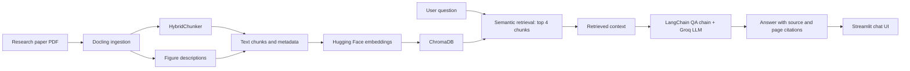

# ResearchIQ — Image-Aware Research Paper Assistant

> Ask questions about academic papers and get answers grounded in retrieved text and figure descriptions, with source and page citations.

   

> **Template note:** This file is pre-filled with verified ResearchIQ details. Replace `TODO` values and adapt the sections when reusing it for another project.

## Demo

 <!-- TODO: add a screenshot or GIF at this path -->

**Live demo:** TODO — add deployment URL

## Problem

Academic papers communicate important findings through both prose and visuals, but text-only question-answering can miss information in figures and diagrams. ResearchIQ processes PDF text and figure descriptions so users can ask questions and receive answers with source and page citations.

## Architecture



## Key features

- Ingests academic PDFs with Docling and splits content with HybridChunker.
- Includes extracted descriptions of figures and diagrams in the retrieval corpus.
- Embeds content with `BAAI/bge-small-en-v1.5` (384-dimensional vectors).
- Uses ChromaDB for persistent vector storage and retrieves the top 4 chunks by default.
- Presents answers with source/page references in an interactive Streamlit chat.

## Tech stack

| Component | Technology |
|---|---|
| Language | Python 3.13+ |
| PDF processing and chunking | Docling, LangChain Docling, HybridChunker |
| Embeddings | Hugging Face, `BAAI/bge-small-en-v1.5` |
| Vector store and retrieval | ChromaDB, semantic similarity search |
| LLM | Groq, `openai/gpt-oss-20b` |
| UI and package management | Streamlit, uv |

## Quick start

### Prerequisites

- Python 3.13 or newer
- [uv](https://docs.astral.sh/uv/)
- A Groq API key

### Install and run

```bash
git clone https://github.com/Yakub019/A-ResearchIQ-Multimodal-Assistant.git
cd A-ResearchIQ-Multimodal-Assistant
uv sync

# Set your own key for this terminal session; never commit secrets.
export GROQ_API_KEY="your_groq_api_key"

# Add PDF papers to data/papers/ before ingestion.
uv run python -m app.ingestion.pdf_loader
uv run python -m app.vectorstore.vector_store
uv run streamlit run streamlit_app.py
```

The app starts locally in Streamlit. Keep API keys in your environment or a gitignored `.env` file; do not commit them.

## Usage example

**Question:** What is the paper's main contribution?

**Answer format (illustrative only; replace with a real result from your test paper):** The paper's main contribution is `[claim supported by retrieved context]`.

**Sources:** `[paper filename]`, p. `[page number]` · `[paper filename]`, p. `[page number]`

## Evaluation

DeepEval is included and evaluation integration is described as initial. Run the project's evaluation workflow and replace the placeholders below with measured results; do not report unmeasured scores.

| Measure | Result |
|---|---:|
| Faithfulness / groundedness | TODO |
| Answer relevance | TODO |
| Citation correctness | TODO |
| Evaluation examples | TODO |

## Project structure

```text
A-ResearchIQ-Multimodal-Assistant/
├── app/
│   ├── ingestion/       # PDF processing
│   ├── embeddings/      # Embedding model
│   ├── vectorstore/     # ChromaDB persistence
│   ├── retrieval/       # Semantic retrieval
│   ├── prompts/         # QA prompts
│   └── chains/          # Answer generation
├── data/papers/         # Input PDFs
├── evals/               # Evaluation resources
├── goldens/             # Evaluation examples
├── main.py
├── streamlit_app.py
├── pyproject.toml
├── requirements.txt
├── uv.lock
└── README.md
```

## Limitations and next steps

- Retrieval and answer quality depend on the input papers and extracted figure descriptions.
- Evaluation integration is still initial; publish a repeatable evaluation set and measured results.
- Planned work includes citation verification, reranking, richer multimodal retrieval, and multi-paper comparison.

## License and contact

**License:** TODO — add a license before describing reuse terms.  
**Contact:** [Yakub Bukya](https://github.com/Yakub019) · LinkedIn: TODO · Email: TODO
